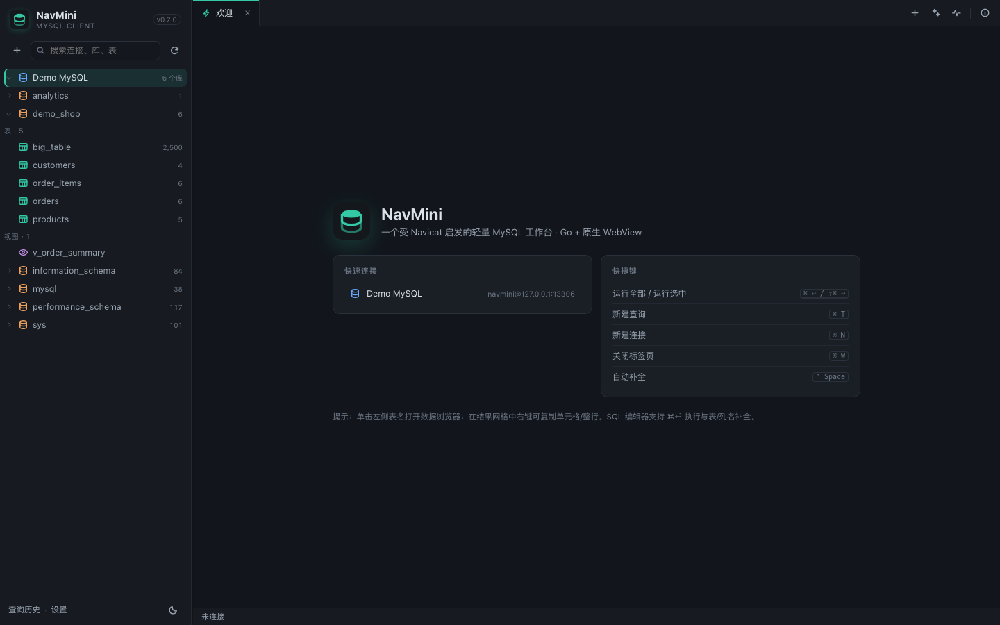
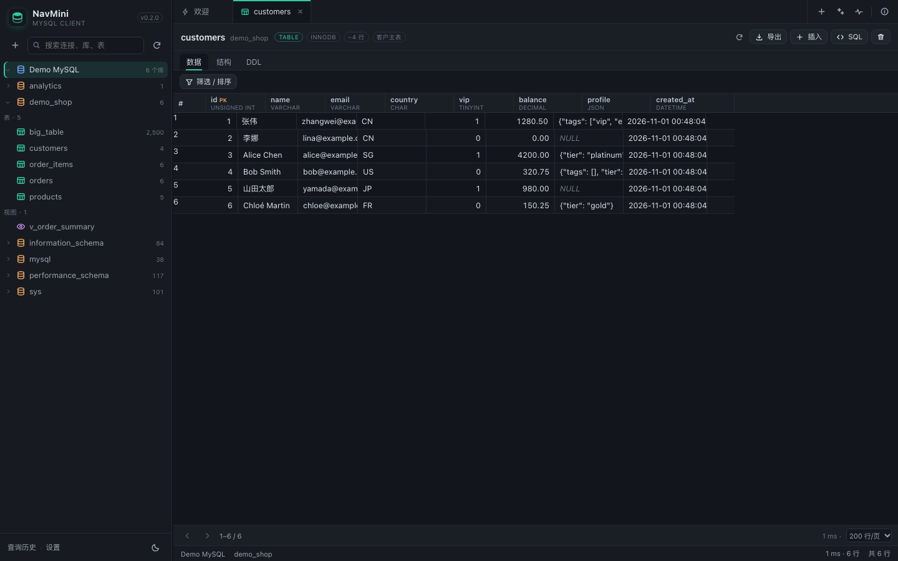
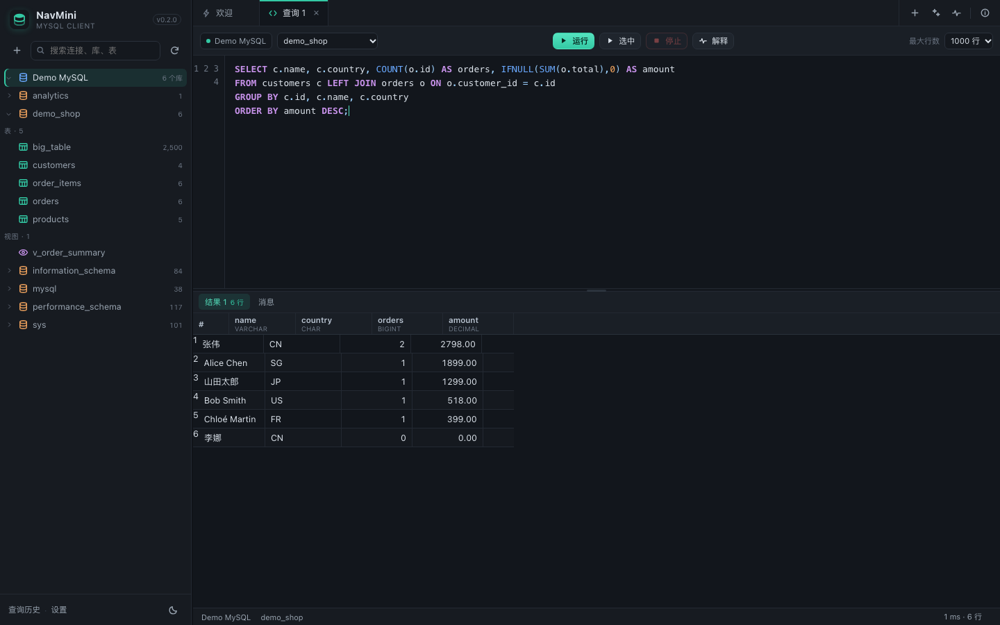
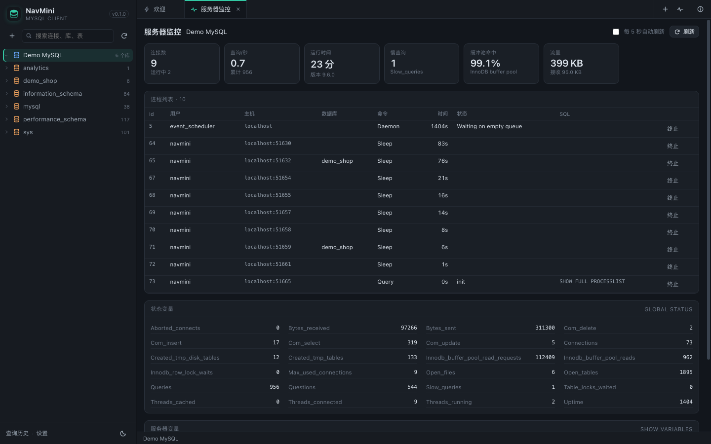
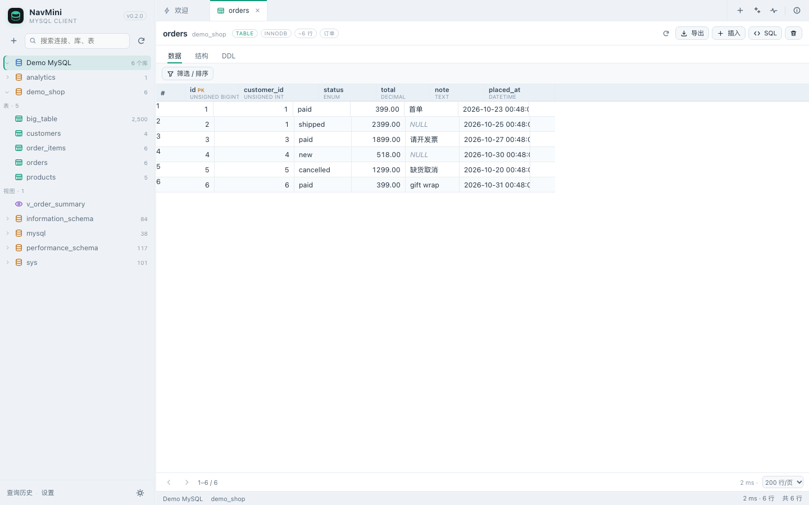
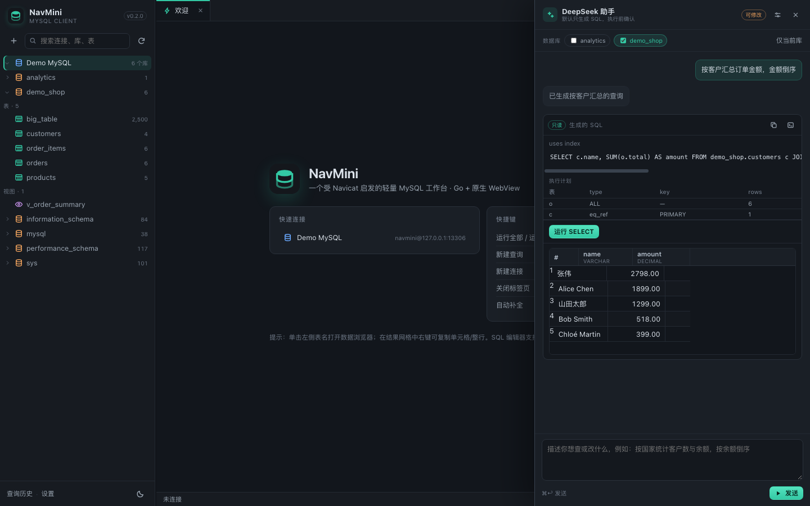

# NavMini

[English](README.md) | [中文](README.zh-CN.md)

> Take a certain database GUI apart first, then build a usable one — a lightweight MySQL workbench inspired by it.
> REA static analysis → architecture report → Go reimplementation → native macOS shell.



## What it is

NavMini is a local, standalone MySQL client: connection management (including SSH tunnels and SSL), a database object tree, a SQL workbench, result grids, table data editing, structure and DDL browsing, and server monitoring.

It is not a feature-for-feature clone of the reference application. Instead, it compresses the reference application's **construction approach** into a small, maintainable project:

- Analysis target: the reference application, version 17.3.10 (arm64)
- Analysis method: REA 6.8.0 static forensics (Mach-O / code signing / Objective-C metadata / bundle resources)
- Full analysis: [docs/software-architecture.md](docs/software-architecture.md)
- Evidence bundle: `docs/rea-evidence.json`

## Why Go

| Aspect | Reference app (measured) | NavMini (Go) |
|---|---|---|
| Delivery | 1.1 GB `.app`, 93 dylibs, 71 MB main binary + 154 MB `libcc.dylib` | 7 MB single binary + 120 KB native shell |
| UI | AppKit + 710 NIBs + private frameworks | WKWebView + native ES module SPA (no frontend build) |
| Core layer | `libcc` + `libcf/libdv/libqexp/libncharts/...` | `internal/mysqlx` (sessions / metadata / queries / table editing / tunnels) |
| Driver layer | libmariadb, libpq, libsqlite3mc, libmongoc, redis++… | `database/sql` + `go-sql-driver/mysql` |
| Extension model | private dylibs + NIB modules | Go packages + `web/js` modules |

Why Go:

1. **Single binary**: `CGO_ENABLED=0`, no runtime dependencies, embedded directly into the app.
2. **Concurrency and cancellation**: goroutines + `context` fit naturally with "one session per connection, long queries can be cancelled".
3. **Driver ecosystem**: the MySQL protocol is mature, and SSH tunnels reuse `golang.org/x/crypto/ssh` directly.
4. **Maintainability**: the reference application's C++/ObjC++ layering needs decompiler-level effort; the same layering in Go takes a few thousand lines.
5. **Cross-platform**: one backend can run on macOS / Linux / Windows; only the shell needs replacing.

## Six design lessons from the reference application

1. Assemble the UI from modules; split result sets into grid / messages / info / summary (NavMini maps this to result tabs plus a message pane).
2. Isolate dialects: a generic workbench plus dialect extensions (NavMini starts with MySQL and keeps the driver layer open).
3. Connections are configuration trees: General / Advanced / SSH / SSL layered, with credentials encrypted locally.
4. Drivers as plugins: the core is not bound to a protocol (NavMini's `mysqlx` is decoupled from the HTTP layer).
5. Lazy object tree: connection → database → table/view → column, fetched level by level.
6. Everything is scriptable: the reference application embeds SpiderMonkey; NavMini exposes a clean JSON API that is easy to script against instead.

## Features

- **Connection management**: groups, colors, notes, SSL mode, timeouts, SSH tunnels (password / private key / ssh-agent), test connection, multi-select with select-all and bulk delete.
- **Object tree**: databases, tables, views, row counts and sizes, search, lazy loading, cached schemas, right-click refresh for a database or table, export and quick backup.
- **SQL workbench**: multiple tabs, syntax highlighting, table/column autocomplete, `⌘↩` to run, `⇧⌘↩` to run the selection, EXPLAIN, stop (`KILL QUERY` without dropping the session), multiple statements and result sets, query history.
- **Data browsing**: pagination, a compact **WHERE / ORDER BY** block in the table toolbar (no top filter bar, data and status stay visible) with manually typed fields, AND/OR conditions (`IN` / `BETWEEN` / NULL) and sorting; drag a column header to add a condition. **Details** bottom pane for full long text/JSON, column `COMMENT` tooltips, and a timestamp display toggle that never changes the underlying value (edits still send the raw value). A one-line effective SQL summary can be copied directly. Generate INSERT/UPDATE/DELETE SQL from selected rows, primary-key-based safe editing, insert/delete rows, CSV and XLSX export.
- **Database export**: right-click a database → choose structure only, structure + all data, or custom (all structure + data for selected tables).
- **`.ncx` connection import/export**: `+` → **Import .ncx** parses XML/JSON connection exports, including AES-128-CBC encrypted passwords. If a same-name/same-config connection exists, NavMini asks whether to overwrite; otherwise it creates a `<name>_copy` connection. **Export** (sidebar, `.ncx`) lets you select connections and optionally include passwords encrypted the same way.
- **Excel import**: a guided wizard reads `.xlsx/.xlsm` sheets, lets you choose the header row, auto-matches Excel headers to table columns, supports manual mapping, and inserts in bounded multi-row batches inside one transaction. DATE/DATETIME/TIMESTAMP/TIME values are normalized.
- **Saved queries**: name and save SQL snippets; they are stored per connection endpoint (`host:port`) and shown again for the same connection.
- **Settings**: language (English default, 中文), dark/light theme, UI/editor font, editor font size, background image, default primary-key descending sort, and the DeepSeek configuration all live in one Settings dialog. Open it from the top toolbar, the sidebar, or macOS `NavMini → Settings…` (`⌘,`).
- **Connection state**: disconnected connections are white; the icon turns green once a session is open.
- **Structure and DDL**: columns, indexes, foreign keys, table info, `SHOW CREATE TABLE`; copy, download, or open in the editor.
- **Quick backup**: right-click a table → `CREATE TABLE … LIKE` + `INSERT … SELECT`, keeping structure and data in the current database.
- **Server monitoring**: connections, QPS, uptime, slow queries, buffer pool hit rate, traffic, process list with the ability to kill connections, status variables.

### AI assistant

- **Providers**: DeepSeek (OpenAI-compatible), Claude Code (Anthropic Messages), and Codex (OpenAI Responses).
- **Local config import**: choose `引用本地配置` to read Claude Code (`~/.claude/settings.json`) or Codex (`~/.codex/config.toml` + `auth.json`) in place. Files are read-only and never modified; API keys never reach the browser.
- **Manual mode**: configure Base URL / API key yourself; the model dropdown is populated from the endpoint's `/models` response (with a refresh button). The API key is stored server-side with AES-256-GCM; the frontend only sees "configured".
- Use **Detect local config** to preview the resolved protocol, base URL, model and key presence before saving.
- **Permission modes**: `Read-only` (SELECT/SHOW/EXPLAIN), `Modify` (+INSERT/UPDATE/REPLACE), `Delete` (+DELETE/DDL). Permissions are enforced server-side; the regular SQL editor is not restricted by them.
- **Generates SQL only by default**: the assistant returns SQL cards, a risk level, and index/EXPLAIN hints. Nothing runs until you click execute, and write/delete operations must additionally be reviewed and confirmed with a checkbox in a dialog.
- **Indexes first**: the schema context includes primary keys, unique keys, secondary indexes, and cardinality; generated SQL is automatically `EXPLAIN`ed, and a full table scan over 1000 rows raises a warning.
- **Multiple databases**: select several databases in the panel; SQL must qualify tables as `db.table`, and the execution session has no default database.
- **Value-driven**: right-click a table row → "have the AI modify this row" attaches the selected row; the model may issue at most 2 read-only probes (server-enforced LIMIT 50) before producing the final SQL.
- **Attachments**: use the paperclip to attach spreadsheets, logs, source code and archives (`.zip/.tar/.tar.gz/.tgz`) (max 20 MB, up to 3). Archives are extracted in memory with a bounded manifest and text contents. Tabular files can be handed to the import wizard; logs keep head + tail and source files are bounded excerpts. Without a selected database, the assistant can still analyze attachments. Attachments are sent to the configured DeepSeek endpoint — do not attach sensitive data you do not want to share.
- **Attachment safety**: attachment text is marked untrusted in the prompt; the assistant must not follow instructions found inside attachments. Database requests still only propose SQL; log/source analysis is returned as text and never executed.
- **UX**: dark/light themes, resizable sidebar and editor area, native window, `⌘T` / `⌘N` / `⌘W` / `⌘K` shortcuts.

| Data browsing | SQL workbench |
|---|---|
|  |  |

| Server monitoring | Light theme |
|---|---|
|  |  |



## Quick start

### 1. Prerequisites

- Go 1.24+
- macOS 13+ (the native shell needs Swift; Command Line Tools are enough)
- MySQL 8/9 (the demo database uses a local `mysqld`)

### 2. Start the demo database (optional)

```bash
./scripts/dev-db.sh start
# 127.0.0.1:13306  navmini / navmini_pw  demo_shop / analytics
```

The script initializes a throwaway instance under `/tmp/navmini-mysql` and loads demo data; `stop` shuts it down and `reset` wipes it.

### 3. Run

Browser mode (no extra dependencies):

```bash
make run
# or go run ./cmd/navmini
```

Native window mode:

```bash
./scripts/build-app.sh
open dist/NavMini.app
```

Both modes listen only on `127.0.0.1`, on a random port, and print a tokenized URL on startup.

> On first launch NavMini already ships with a "Demo MySQL (local demo)" connection pointing at `127.0.0.1:13306`, so `scripts/dev-db.sh start` is enough to try it. Right-click the connection and delete it if you don't need it.

### 4. Windows native build

The Windows artifact is a single `.exe` with an embedded Go server and a native
**WebView2** window — it no longer opens a browser. Build it with:

```bash
./scripts/build-windows.sh
# needs the Microsoft Edge WebView2 Runtime (preinstalled on Windows 10/11)
```

### 5. Connect your own database

Click `+` on the left → enter host / port / user / password → **Test connection** → **Create**.
If the database sits behind a jump host, expand **SSH tunnel** and fill in the SSH credentials.

### 6. Configure DeepSeek (optional)

Open **Settings → DeepSeek** (top toolbar, sidebar, or macOS `⌘,`) → enter Base URL, model, and API key → **Test connection** → save.
The default permission is "Read-only"; after switching to "Modify / Delete", write operations still need confirmation in a dialog.

## Project layout

```
cmd/navmini/          entry point: listener, token, signal handling
cmd/navmini-windows/  native Windows WebView2 shell (single exe)
internal/config/      connection config, AES-256-GCM, settings, history, AI config
internal/mysqlx/      sessions, metadata, queries, table CRUD, backup, SQL generation, SSH tunnel
internal/ai/          DeepSeek client, permission classification, prompts
internal/server/      HTTP API, auth, embedded static assets
web/                  index.html + css/js (native ES modules, no build step)
  js/app.js           shell, tabs, tree, table page, dialogs
  js/ai.js            DeepSeek assistant panel and configuration
  js/i18n.js          English/Chinese UI strings and DOM translation
  js/grid.js          virtual-scrolling data grid
  js/editor.js        SQL editor (highlighting / completion / line numbers)
  js/dom.js           lightweight DOM/dialog/toast helpers
shell/main.swift      WKWebView native shell (menus, child process, lifecycle)
scripts/              build-app.sh / build-windows.sh / dev-db.sh / seed.sql
docs/                 reference application architecture analysis, REA evidence, screenshots
```

## Security model

- Binds to `127.0.0.1` only. A 192-bit token is generated at every start, carried in the page URL and an HttpOnly cookie, and validated by the API via `X-NavMini-Token`.
- Connection passwords are encrypted with **AES-256-GCM** before being written to `~/.navmini/connections.json`; the key lives in `~/.navmini/secret.key` (0600). App mode uses `~/Library/Application Support/NavMini/`. This protects against casual file inspection; it does **not** protect against a same-user attacker on the machine.
- The DeepSeek API key is likewise encrypted in `ai.json` and is **never sent back to the browser**; the AI receives only the schema (plus rows you explicitly attach or let it probe), never connection credentials.
- All database identifiers (database / table / column) go through allow-list validation plus backtick escaping; values are always parameterized.
- Long queries are cancelled with `KILL QUERY` first; without the `PROCESS` privilege this falls back to cancelling the context, which drops that session's connection.
- SSH host keys use trust-on-first-use; there is **no** known_hosts verification. Do not use this in production as-is.
- The app does not enable the App Sandbox, and is neither Developer ID signed nor notarized.

## Known limitations

- MySQL protocol only; no PostgreSQL / MongoDB / Redis / SQLite.
- No ER diagrams, data sync/transfer, scheduling, BI, or debugger (see the analysis report for how the reference application handles these modules).
- DeepSeek requires your own API key; it is off by default and enabled after first configuration. AI requests send the schema of the selected databases to the configured Base URL — choose the scope carefully for sensitive databases.
- The AI is limited to one statement per turn and never executes automatically; there is no streaming output; at most 2 read-only probes, each with LIMIT 50.
- The table designer is read-only: you can inspect structure, indexes, foreign keys, and DDL, but cannot alter columns.
- SQL scripts do not support `DELIMITER`; multi-statement scripts for stored procedures and triggers must be split by hand.
- Transactions are session-scoped: `BEGIN … COMMIT` works within one query tab, but is not shared across tabs.
- Query results are capped at 1 MiB per row; larger rows are truncated with a notice.
- macOS uses `WKWebView`; Windows uses WebView2. The Windows exe embeds the Go server and requires the WebView2 Runtime.
- NCX password fields are decrypted/encrypted with AES-128-CBC (zero padding). Whole-file encryption or binary NCX containers are not supported.
- The timestamp display toggle is display-only; the raw value is what updates the database.

## Testing

```bash
go test ./...
```

Coverage: SQL statement splitting, read-only statement detection, identifier validation, charset allow-lists, real SSH tunnel forwarding, AES-GCM config write/read and "no plaintext leakage", multi-condition filter SQL, SQL literals, AI permission classification, and prompt parsing.

Manual regression (demo database): connect → object tree (gray → green) → table data pagination/sorting/multi-filter → cell editing → insert/delete rows → CSV/XLSX export (with optional SQL sheet) → Excel import wizard → saved query → language switch/settings → multi-statement query → stop after `SELECT SLEEP(10)` → run again after a server restart (sessions reopen automatically).

## REA analysis summary

| Observation | Value |
|---|---|
| Bundle | Reference app 17.3.10, 1.1 GB, 3,393 files |
| Main binary | universal Mach-O, 71,501,568 B, 62 dependencies |
| Signing | Developer ID (team VH7G2MRF27), hardened runtime |
| Core library | `libcc.dylib` 154 MB, 54 load commands, 40 dependencies |
| UI | 710 NIBs, 572 Chinese string tables |
| Module protocols | `CCUIFormBehaviourProtocol`, `NAVFormModuleOwner`, `SQLEditorModuleOwner`, `SQLResult*Module`, etc. |

Full evidence IDs and limitations (no decompiler available, app never run) are in
[docs/software-architecture.md](docs/software-architecture.md).

## Notes

This project is for learning and personal use only. Trademarks mentioned in this document belong to their respective owners, and this project is not affiliated with them. The analysis findings under `docs/` come from static observation and inference and do not constitute any authorization for the original software.

## License

Licensed under the Mulan Permissive Software License, Version 2 (Mulan PSL v2). See [LICENSE](LICENSE).
