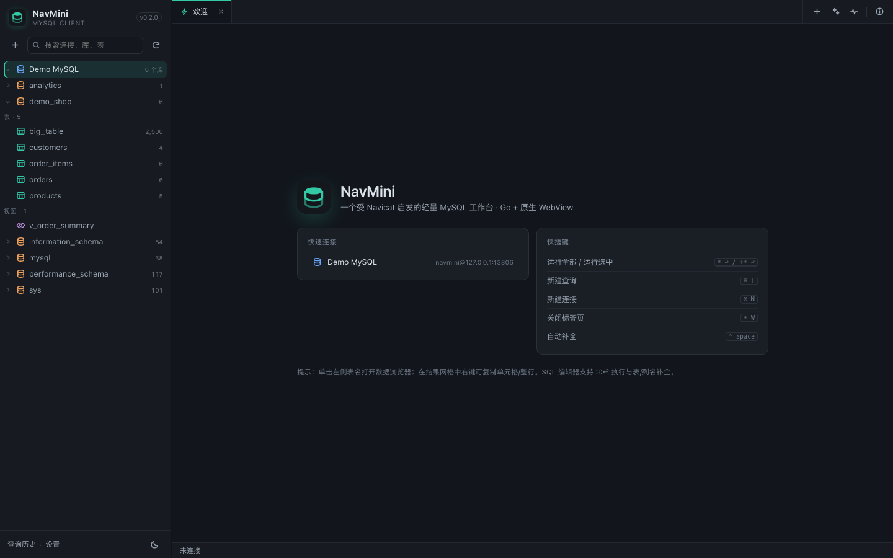
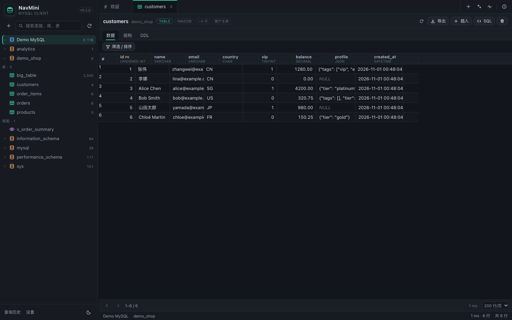
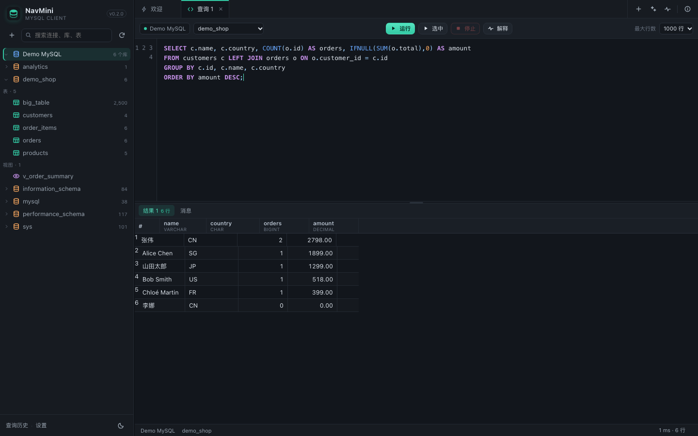
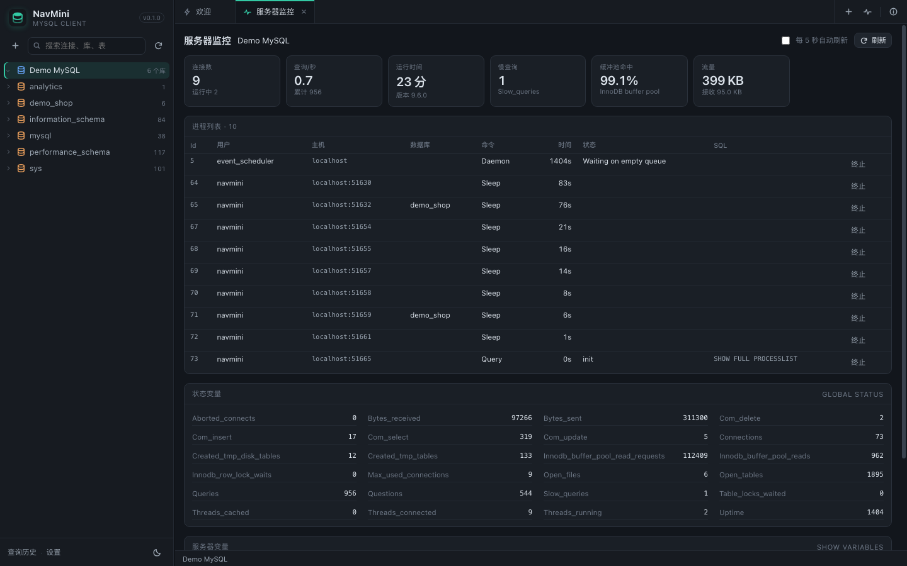
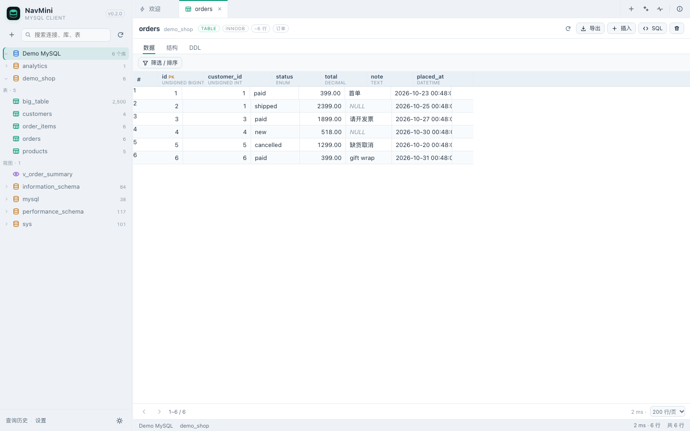
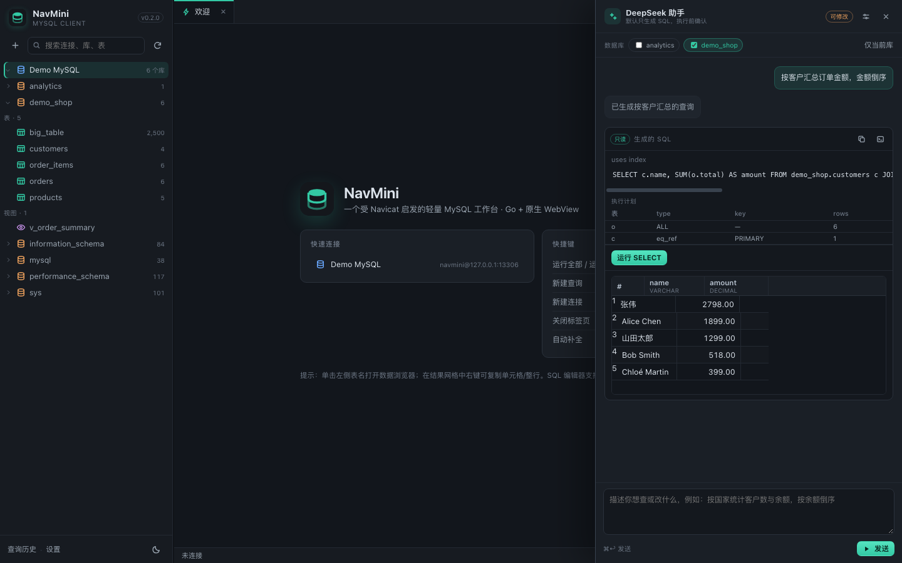

# NavMini

[English](README.md) | [中文](README.zh-CN.md)

> 先拆某软件，再写一个能用的 —— 一个受其启发的轻量 MySQL 工作台。
> REA 静态分析 → 架构报告 → Go 重实现 → 原生 macOS 外壳。



## 这是什么

NavMini 是一个本地单机 MySQL 客户端：连接管理（含 SSH 隧道 / SSL）、库表对象树、SQL 工作台、
结果网格、表数据编辑、结构与 DDL 浏览、服务器监控。

它不是某软件的功能复刻，而是把某软件的**构造方式**压缩成一个可维护的小项目：

- 分析对象：某软件 17.3.10（arm64）
- 分析方法：REA 6.8.0 静态取证（Mach-O / 签名 / Objective-C 元数据 / bundle 资源）
- 完整分析：[docs/software-architecture.md](docs/software-architecture.md)
- 证据包：`docs/rea-evidence.json`

## 为什么推荐 Go

| 维度 | 某软件（实测） | NavMini（Go 实现） |
|---|---|---|
| 交付形态 | 1.1 GB `.app`，93 个 dylib，主程序 71 MB + `libcc.dylib` 154 MB | 7 MB 单二进制 + 120 KB 原生外壳 |
| UI | AppKit + 710 个 NIB + 私有框架 | WKWebView + 原生 ES Module 单页（无前端构建） |
| 核心层 | `libcc` + `libcf/libdv/libqexp/libncharts/...` | `internal/mysqlx`（会话/元数据/查询/表编辑/隧道） |
| 驱动层 | libmariadb、libpq、libsqlite3mc、libmongoc、redis++… | `database/sql` + `go-sql-driver/mysql` |
| 扩展方式 | 私有 dylib + NIB 模块 | Go 包 + `web/js` 模块 |

选择 Go 的原因：

1. **单二进制**：`CGO_ENABLED=0`，无运行时依赖，App 直接内嵌。
2. **并发与取消**：goroutine + `context` 天然适合「一个连接一个会话、长查询可取消」。
3. **驱动生态**：MySQL 协议成熟；SSH 隧道直接复用 `golang.org/x/crypto/ssh`。
4. **可维护性**：某软件的 C++/ObjC++ 分层需要反编译器级别的人力；同样的分层用 Go 只要几千行。
5. **跨平台**：同一后端可跑 macOS / Linux / Windows，外壳可替换。

## 从某软件借鉴的 6 条设计

1. UI 按「模块」拼装，结果集拆成网格 / 消息 / 信息 / 摘要（NavMini 对应结果标签 + 消息页）。
2. 方言隔离：通用工作台 + 方言扩展（NavMini 先做 MySQL，驱动层预留）。
3. 连接即配置树：General / Advanced / SSH / SSL 分层，凭据本地加密。
4. 驱动插件化：核心不绑定协议（NavMini 的 `mysqlx` 与 HTTP 层解耦）。
5. 对象树懒加载：连接 → 库 → 表/视图 → 列，逐级拉取。
6. 一切可脚本化：某软件内置 SpiderMonkey；NavMini 用清晰的 JSON API，便于再脚本化。

## 功能

- **连接管理**：分组、颜色、备注、SSL 模式、超时、SSH 隧道（密码 / 私钥 / ssh-agent）、测试连接。
- **对象树**：库、表、视图、行数/大小、搜索、懒加载、右键导出与快速备份。
- **SQL 工作台**：多标签、语法高亮、表/列自动补全、`⌘↩` 运行、`⇧⌘↩` 运行选中、EXPLAIN、
  停止（`KILL QUERY`，会话不中断）、多语句/多结果集、查询历史。
- **数据浏览**：分页；表工具栏 **WHERE** 条件（不再占用顶部的筛选条），字段可手动输入，
  支持 AND/OR、`IN` / `BETWEEN` / NULL 与排序；可拖动表头添加条件。**详情**底部面板展示
  大文本/JSON；字段 COMMENT 悬浮提示；时间戳显示开关只改变显示，编辑仍提交原始值。
  单行 SQL 摘要可一键复制。选中行生成 INSERT/UPDATE/DELETE SQL、基于主键的安全编辑、
  插入/删除行、CSV / XLSX 导出。
- **数据库导出**：库右键 → 仅结构、结构+全部数据、或自定义（全部结构 + 指定表数据）。
- **某软件 `.ncx` 连接导入**：`+` → **导入 .ncx**；解析明文 XML/JSON 连接导出。加密/二进制 NCX 会明确报错。
- **Excel 导入**：向导读取 `.xlsx/.xlsm` 的 sheet，选择表头行，按表头名称自动匹配目标列，
  支持手动映射；服务端在事务中按批插入。DATE/DATETIME/TIMESTAMP/TIME 会做格式归一化。
- **已保存查询**：给 SQL 命名保存，按连接端点（`host:port`）存储，再次连接同一地址时显示。
- **设置**：语言（默认英语 / 中文）、深浅色主题、界面/编辑器字体、字号、背景图片，
  默认主键倒序、以及 DeepSeek 配置，统一放在设置里；可从顶部工具栏、侧栏或 macOS 菜单
  `NavMini → 设置…`（`⌘,`）打开。
- **连接状态**：未连接为白色，会话打开后图标变绿。
- **结构与 DDL**：列、索引、外键、表信息、`SHOW CREATE TABLE`，可复制/下载/在编辑器中打开。
- **快速备份**：右键表 → `CREATE TABLE … LIKE` + `INSERT … SELECT`，当前库留存结构与数据。
- **服务器监控**：连接数、QPS、运行时间、慢查询、缓冲池命中、流量、进程列表与终止连接、状态变量。

### DeepSeek 助手

- 在 **设置 → DeepSeek** 里配置 **Base URL / 模型 / API Key**，支持 `deepseek-chat` 与 `deepseek-reasoner`；
  API Key 用 AES-256-GCM 存在服务端，前端只看到“已配置”。
- **权限模式**：`只读`（SELECT/SHOW/EXPLAIN）、`可修改`（+INSERT/UPDATE/REPLACE）、
  `可删除`（+DELETE/DDL）。权限由服务端强制校验，普通 SQL 编辑器不受此限制。
- **默认只生成 SQL**：助手返回 SQL 卡片、风险级别、索引/EXPLAIN 提示；点击执行才运行，
  写/删操作还需在弹窗里核对并勾选确认。
- **索引优先**：Schema 上下文包含主键、唯一键、二级索引和基数；生成后自动 `EXPLAIN`，
  全表扫描超过 1000 行会给出提示。
- **多库**：面板可多选数据库，SQL 要求 `db.table` 限定；执行会话不预设默认库。
- **值驱动**：可右键表格行“让 AI 修改此行”附带选中行；模型最多可发起 2 条只读探测
  （服务端强制 LIMIT 50），再生成最终 SQL。
- **附件**：助手输入框的回形针可附加 `.xlsx/.xlsm/.csv/.tsv/.txt/.sql/.md/.json`
  （最大 20 MB，最多 3 个）。表格附件会解析 sheet/表头/预览，并可直接交给当前表的导入向导；
  文本/SQL 作为有长度限制的不可信上下文。附件会发送到你配置的 DeepSeek 端点，
  敏感数据请谨慎附加。
- **附件安全**：提示词明确把附件标为不可信数据，助手不得执行附件里的指令，且仍只生成 SQL、不自动执行。
- **体验**：深/浅主题、可拖拽侧栏与编辑区、原生窗口、`⌘T` / `⌘N` / `⌘W` / `⌘K` 快捷键。

| 数据浏览 | SQL 工作台 |
|---|---|
|  |  |

| 服务器监控 | 浅色主题 |
|---|---|
|  |  |



## 快速开始

### 1. 环境

- Go 1.24+
- macOS 13+（原生外壳需要 Swift，Command Line Tools 即可）
- MySQL 8/9（示例库用本机 `mysqld`）

### 2. 启动示例库（可选）

```bash
./scripts/dev-db.sh start
# 127.0.0.1:13306  navmini / navmini_pw  demo_shop / analytics
```

脚本会在 `/tmp/navmini-mysql` 初始化一个一次性实例并写入演示数据；`stop` / `reset` 可停止或清空。

### 3. 运行

浏览器模式（零额外依赖）：

```bash
make run
# 或 go run ./cmd/navmini
```

原生窗口模式：

```bash
./scripts/build-app.sh
open dist/NavMini.app
```

两种模式都只监听 `127.0.0.1` 的随机端口，并在启动时打印带随机 token 的 URL。

> 首次启动时，NavMini 已预置一个指向 `127.0.0.1:13306` 的「Demo MySQL (本地示例)」连接，
> 配合 `scripts/dev-db.sh start` 可直接体验；不需要时在连接上右键删除即可。

### 4. Windows 原生构建

Windows 产物是单个 `.exe`，内嵌 Go 服务并使用原生 **WebView2** 窗口，不再打开浏览器：

```bash
./scripts/build-windows.sh
# 需要 Microsoft Edge WebView2 Runtime（Win10/11 通常已预装）
```

### 5. 连接自己的数据库

在左侧点 `+` → 填主机/端口/用户/密码 → **测试连接** → **创建**。
若数据库在跳板机后，展开 **SSH 隧道** 并填写 SSH 凭据。

### 6. 配置 DeepSeek（可选）

打开右上角 **AI 助手** → 齿轮 → 填 Base URL、模型、API Key → **测试连接** → 保存。
默认权限为「只读」；切换到「可修改 / 可删除」后，写操作仍需在弹窗中确认。

## 目录

```
cmd/navmini/          入口：监听、token、信号处理
internal/config/      连接配置、AES-256-GCM、设置、历史、AI 配置
internal/mysqlx/      会话、元数据、查询、表 CRUD、备份、SQL 生成、SSH 隧道
internal/ai/          DeepSeek 客户端、权限分类、Prompt
internal/server/      HTTP API、鉴权、嵌入静态资源
web/                  index.html + css/js（原生 ES modules，无构建步骤）
  js/app.js           壳、标签、树、表格页、对话框
  js/ai.js            DeepSeek 助手面板与配置
  js/i18n.js          中英文 UI 文案与 DOM 翻译
  js/grid.js          虚拟滚动数据网格
  js/editor.js        SQL 编辑器（高亮 / 补全 / 行号）
  js/dom.js           轻量 DOM/弹窗/Toast 工具
shell/main.swift      WKWebView 原生外壳（菜单、子进程、生命周期）
scripts/              build-app.sh / dev-db.sh / seed.sql
docs/                 某软件架构分析、REA 证据、截图
```

## 安全模型

- 只绑定 `127.0.0.1`；每次启动生成 192-bit token，页面 URL 与 HttpOnly cookie 携带，API 校验
  `X-NavMini-Token`。
- 连接密码使用 **AES-256-GCM** 加密后写入 `~/.navmini/connections.json`；密钥
  `~/.navmini/secret.key`（0600）。App 模式使用 `~/Library/Application Support/NavMini/`。
  这能防"误看文件"，**不能**防本机同用户攻击。
- DeepSeek API Key 同样加密存储在 `ai.json`，**不会回传浏览器**；AI 只接收 schema
  （和用户明确附带/探测的行），不发送连接凭据。
- 所有数据库标识符（库/表/列）都经过白名单校验 + 反引号转义；值一律参数化。
- 取消长查询优先用 `KILL QUERY`；没有 `PROCESS` 权限时回退为取消上下文（会断开该会话连接）。
- SSH 主机密钥采用首次自动信任，**没有** known_hosts 校验；生产环境请勿直接使用。
- 应用未开启 App Sandbox，也未做 Developer ID 签名 / 公证。

## 已知限制

- 仅支持 MySQL 协议；没有 PostgreSQL / MongoDB / Redis / SQLite。
- 没有 ER 图、数据同步/传输、调度、BI、调试器（某软件的这些模块见分析报告）。
- DeepSeek 需要自备 API Key；默认关闭，首次配置后启用。AI 请求会把所选库的 schema
  发到配置的 Base URL；敏感库请谨慎选择范围。
- AI 每次只允许一条语句、不自动执行；不支持流式输出；只读探测最多 2 条、每条 LIMIT 50。
- 表设计器只读：能看结构、索引、外键和 DDL，不能改列。
- SQL 脚本不支持 `DELIMITER`；存储过程/触发器的多语句脚本需要手工拆分。
- 事务依赖会话：同一查询标签内的 `BEGIN … COMMIT` 可用，跨标签不共享事务。
- 查询结果单行上限 1 MiB，超出会截断并提示。
- 原生外壳使用 `WKWebView`，首次运行会由系统创建 WebKit 缓存目录；无网络上传行为。

## 测试

```bash
go test ./...
```

覆盖：SQL 语句切分、只读语句识别、标识符校验、字符集白名单、SSH 隧道真实转发、
AES-GCM 配置落盘/回读与"不泄漏明文"、多条件筛选 SQL、SQL 字面量、AI 权限分类与 Prompt 解析。

手工回归（示例库）：连接 → 对象树 → 表数据分页/排序/筛选 → 单元格编辑 → 插入/删除行 →
CSV 导出 → 多语句查询 → `SELECT SLEEP(10)` 后停止 → 服务重启后再次运行（自动重开会话）。

## REA 分析摘要

| 观测 | 值 |
|---|---|
| Bundle | 某软件 17.3.10，1.1 GB，3,393 个文件 |
| 主程序 | universal Mach-O，71,501,568 B，62 个依赖 |
| 签名 | Developer ID（team VH7G2MRF27），hardened runtime |
| 核心库 | `libcc.dylib` 154 MB，54 个 load command，40 个依赖 |
| UI | 710 个 NIB，572 个中文字符串表 |
| 模块协议 | `CCUIFormBehaviourProtocol`、`NAVFormModuleOwner`、`SQLEditorModuleOwner`、`SQLResult*Module` 等 |

完整证据 ID、局限（无反编译器、未运行 App）见
[docs/software-architecture.md](docs/software-architecture.md)。

## 说明

本项目仅用于学习与自用；文中提到的「某软件」相关商标归其权利人所有，本项目与其官方无关。
`docs/` 中的分析结论来自静态观测与推断，不构成对原软件的任何授权。

## 许可证

木兰宽松许可证，第 2 版（Mulan PSL v2），见 [LICENSE](LICENSE)。
